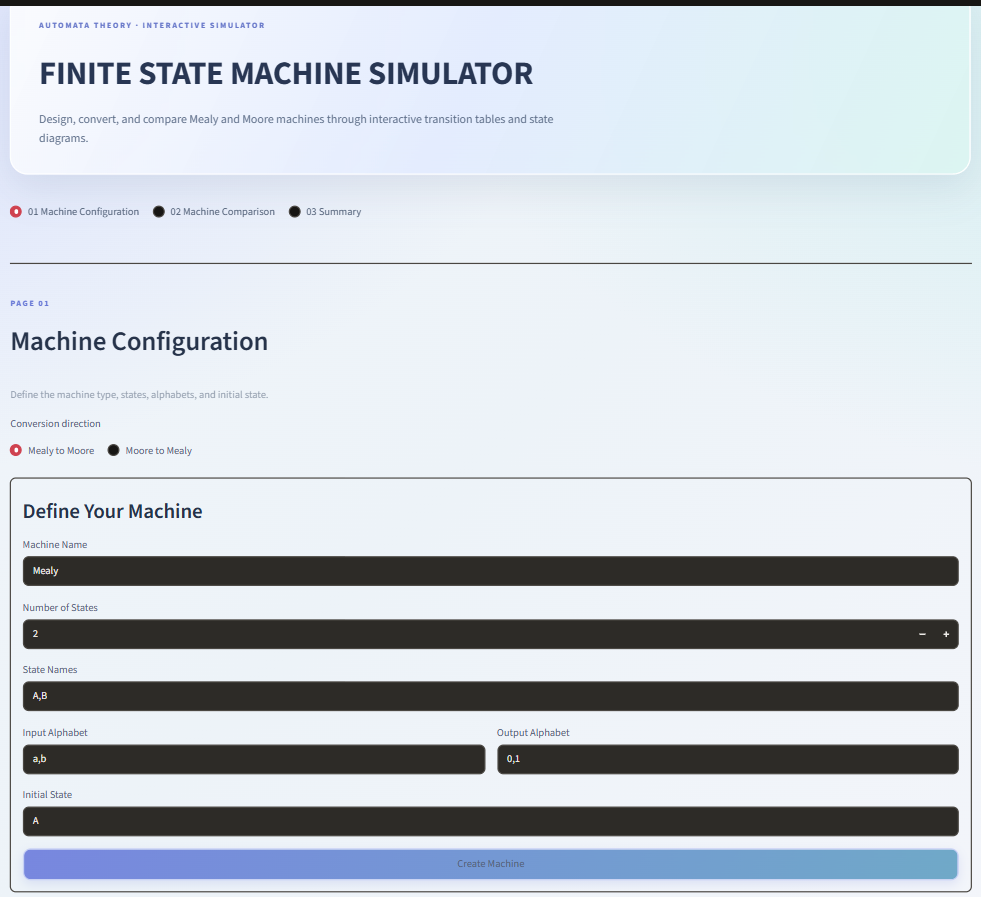
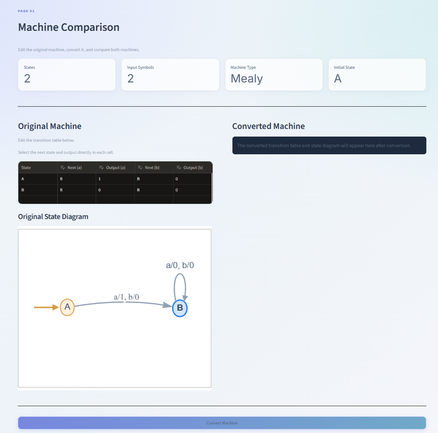
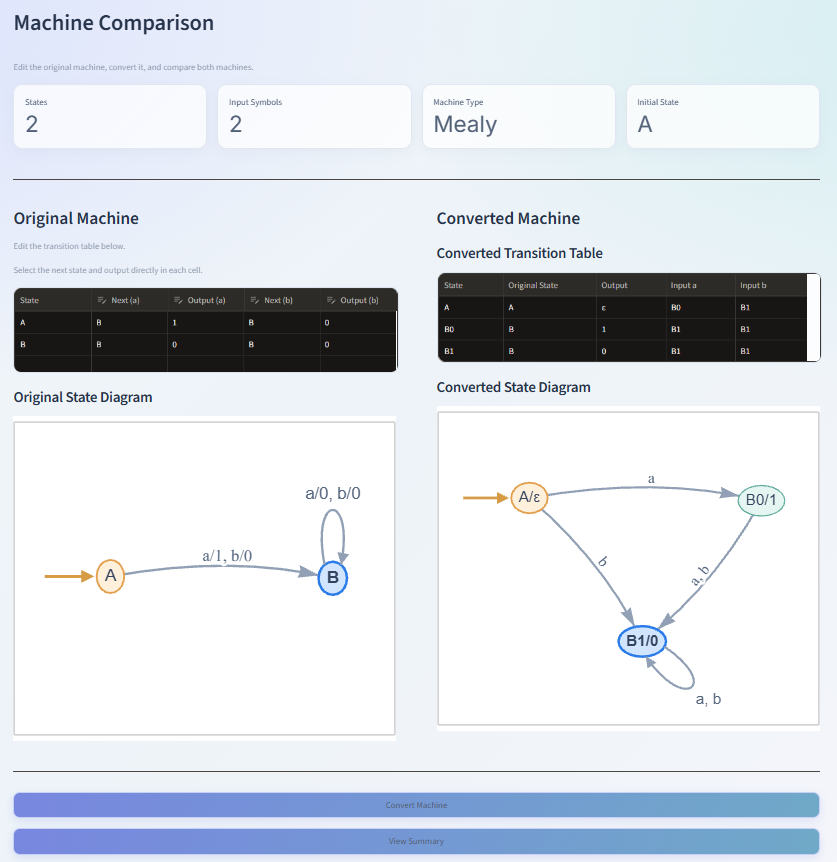
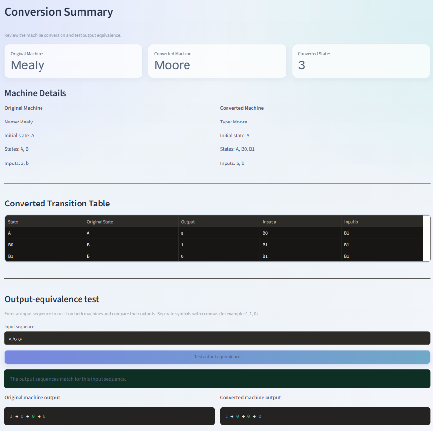

# AutomataBridge
### Interactive Mealy and Moore Finite State Machine Simulator

## Overview

AutomataBridge is an interactive web-based application built using Python and Streamlit. It allows users to create, visualize, compare, and convert Mealy and Moore finite state machines.

The application provides an interactive environment for understanding finite state machines and their behavior through transition tables and state diagrams.

## Live Demo

Try AutomataBridge here:

**Live Application:** https://automatabridge.streamlit.app/

**Source Code:** https://github.com/nirbhay2510/AutomataBridge

## Features

- **Machine Configuration:** Define states, input symbols, output symbols, and initial states.
- **Editable Transition Tables:** Create and modify state transitions and outputs.
- **State Diagram Visualization:** Visualize machines with transitions, labels, initial arrows, and self-loops.
- **Mealy to Moore Conversion:** Convert Mealy machines into equivalent Moore machines.
- **Moore to Mealy Conversion:** Convert Moore machines into equivalent Mealy machines.
- **Machine Comparison:** View the original and converted machines side by side.
- **Equivalence Testing:** Compare machine behavior to check whether the converted machine is equivalent to the original.

## Technologies Used

- Python
- Streamlit
- Pandas
- PyVis
- HTML
- CSS

## Project Structure

```text
AutomataBridge/
│
├── app.py
│
└── modules/
    ├── __init__.py
    ├── machine_config.py
    ├── transition_table.py
    ├── state_diagram.py
    ├── conversion.py
    └── ui_theme.py
```

## Installation and Setup

### 1. Clone the Repository

```bash
git clone https://github.com/nirbhay2510/AutomataBridge.git
```

### 2. Navigate to the Project Directory

```bash
cd AutomataBridge
```

### 3. Install Dependencies

```bash
pip install -r requirements.txt
```

### 4. Run the Application

```bash
streamlit run app.py
```

The application will open in your default web browser.

## How to Use

1. Open the application.
2. Configure a Mealy or Moore machine by defining its states, inputs, outputs, and initial state.
3. Fill in or edit the transition table.
4. Generate and inspect the state diagram.
5. Select the required conversion direction.
6. Compare the original and converted machines.
7. Use equivalence testing to examine whether both machines produce equivalent behavior.

## Application Screenshots

## Application Screenshots

### Home Page


### Transition Table and State Diagram


### Machine Conversion


### Summary and Equivalence Testing


## Author

**Nirbhay Sisodia**